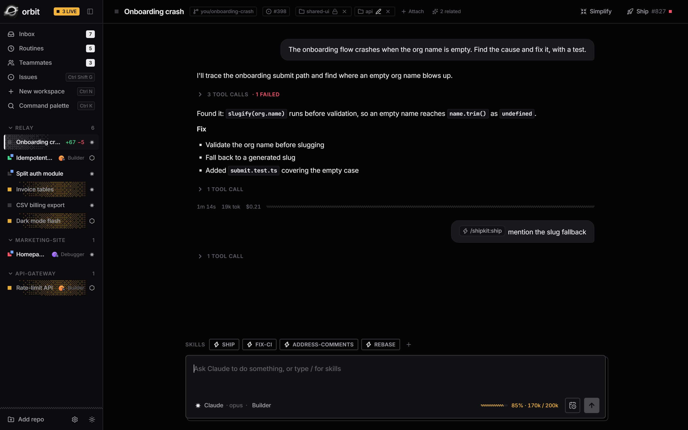

<div align="center">


# Orbit

**Run a fleet of coding agents in parallel, and ship what they build.**

Orbit is a desktop app for developers who work with Claude Code and Codex all day.<br/>
Every task gets its own git worktree, branch and agent. You get one inbox for all of them, and a straight line from diff to merged PR.

[](https://github.com/SGranquist13/orbit/releases/latest)
[](https://github.com/SGranquist13/orbit/actions/workflows/ci.yml)
[](#requirements)
[](LICENSE)

[**Download**](https://github.com/SGranquist13/orbit/releases/latest) · [Quick start](#quick-start) · [Features](#features) · [FAQ](#faq) · [Changelog](CHANGELOG.md)

<!-- release:start (written by `bun run release`) -->
**New in [v0.2.1](https://github.com/SGranquist13/orbit/releases/tag/v0.2.1):** Nine new previews for running and steering agents: plans, limits, rewind, MCP servers, reviews, Best of N and more.
<!-- release:end -->

<br/>



</div>

## Why Orbit

Coding agents are good enough to work in parallel, but a terminal per agent doesn't scale. You lose track of which one is waiting on you, they trample each other's files, and every finished task still needs the same commit, push, PR, CI and merge routine.

Orbit is the control room for that workflow:

- **Isolation by default.** Each workspace is a real git worktree on its own branch. Ten agents can work on one repo without touching each other or your checkout.
- **Attention, not tabs.** An inbox shows only the sessions that need you: finished, failed, asking a question, or blocked by red CI. Each comes with suggested replies you can send in one keystroke.
- **Built for shipping.** Commit, push, draft PR, checks, Fix CI, review comments and merge, all from one panel. Orbit runs your checks before anything leaves your machine.

Agents write the code; Orbit keeps the fleet organised and moving. When you want to see exactly what an agent is doing, the built-in **Code view** follows its edits live.

## How it works

```
  New workspace ─▶ worktree + branch ─▶ agent works ─▶ Inbox: "needs you" ─▶ Ship ─▶ PR ─▶ CI ─▶ merge
  (Ctrl+N)         ~/.orbit/worktrees    Claude/Codex   reply, or hand off       checks first     auto-archive
```

1. **Start a task** from a prompt, a GitHub issue, or a routine. Orbit creates a worktree and branch and starts the agent, running Claude Code or Codex, on your existing CLI login.
2. **Keep working** while it runs. Start more. The sidebar shows every workspace's status and diff at a glance.
3. **Answer the inbox** when something needs you: approve a plan, reply to a question, or hand the work to a reviewer.
4. **Ship** when it's done: Orbit runs your checks, squashes its save points, opens a draft PR, watches CI, fixes failures and merges. Then it cleans up the worktree.

## Quick start

1. **Install the prerequisites:** [Claude Code](https://claude.com/claude-code) and/or the [Codex CLI](https://github.com/openai/codex), logged in, plus `git`. For the GitHub features, also install the [GitHub CLI](https://cli.github.com) (`gh auth login`).
2. **Download** `Orbit_x.y.z_x64-setup.exe` from [Releases](https://github.com/SGranquist13/orbit/releases/latest) and run it.
   > The installer isn't code-signed yet, so Windows SmartScreen will warn you. Click **More info → Run anyway**.
3. **Add a repository** (bottom-left of the sidebar) and press **Ctrl+N** to start your first workspace.
4. Give it a task, switch to something else, and come back when the **Inbox** (Alt+1) says it's done.

> Want to look around without agents or accounts? Run the UI in mock mode (see [Build from source](#build-from-source)).

## Features

### Fleet of workspaces
- One **git worktree + branch per task**. Claude Code and Codex run side by side, with streaming chat, tool-call groups, interrupt, and resume after restart.
- **Images and files in chat:** paste, drop or attach them. Images go to Claude and Codex natively; files as paths the agent reads itself.
- Model lists come straight from the agent CLIs, plus any custom model id.
- **Profiles:** Builder, Debugger, Planner, Reviewer, Shipper, Ticket writer. Read-only roles are **enforced**, not just prompted.
- **Attach folders** (read-only or editable) and discover related projects (package.json, Cargo.toml, pyproject, go.mod), so agents can work across repos.
- **Context meter** per session, with Compact and New session; per-turn tokens and cost, and a usage report.

### Attention inbox
- Workspaces that finished, failed, asked something, have failing checks or need a sync.
- **Suggested replies**, from rules or a cheap AI pass, sent with a number key. Inline reply, dismiss, snooze, `j`/`k` navigation.

### Code view
- A built-in editor (CodeMirror 6): explorer, tabs, quick open, find and replace, project search, terminal, git gutter and side-by-side diffs.
- **Watch mode** follows the agent as it edits: change flashes, gutter marks and a per-turn activity timeline. Edits stream in as the agent writes them.
- Select some lines and **ask the agent about them** (Ctrl+I).

### Voice (preview)
- **Dictate** into any chat with the mic button, or hold `Ctrl+Shift+Space` to talk.
- **Hands-free:** talk, pause, and it sends. Replies are read aloud as the agent writes them, and talking over it stops it.
- A **natural voice** (Kokoro) reads replies aloud. Speech recognition (Whisper) and speech both run on your computer; a one-time setup downloads them.

### Ship to GitHub
- **Ship panel:** commit, push, draft PR, live checks, *Fix CI*, *Address comments*, *Ready for review*, *Squash & merge*.
- **Trunk-friendly git:** save-point commits after each turn (with *Undo last turn*), squashed before shipping, plus a ship gate that runs your project's check command first. Merged workspaces archive themselves.
- **Issues:** browse a repo's issues, start or plan a workspace from one (`Closes #n` included), and turn rough notes into a well-formed ticket.
- **Preflight:** before shipping, checks boundary changes against their consumers in this repo and attached folders.

### Skills
- Install **skill packs** from any git URL; they use the standard Claude plugin layout. `/` autocomplete, pinned skill chips, palette entries.
- Bundled **shipkit** pack: `ship`, `preflight`, `fix-ci`, `address-comments`, `rebase`, `write-ticket`, `start-issue`.
- Codex can run the same packs too: Orbit inlines the skill for it.

### AI teammates
- **Named teammates** with their own instructions and memory. Hand one a task in chat; it creates its own workspace and reports back.
- **Chief** turns a vague request into a plan of parts for other teammates. Parts run in dependency order, and you get a combined report.
- **Hand-off chips** move work along: Planner → Builder → Reviewer → Shipper.

### Routines and Simplify
- **Routines:** scheduled agent runs ("every Monday at 9", "weekdays at 17:00", or cron). Runs that find nothing to do archive themselves quietly.
- **Simplify:** a read-only pass finds cleanups in your diff and applies the low-risk ones one at a time. Each lands in its own commit, and any that breaks your checks is reverted.

### Made for the keyboard
VS Code keybindings throughout, including the editor and `Ctrl+K` chords.

| Shortcut | Action | Shortcut | Action |
|---|---|---|---|
| `Ctrl+Shift+P` / `F1` | Command palette | `Ctrl+Shift+G` | Ship panel |
| `Ctrl+N` | New workspace | `Ctrl+1…9` | Jump to workspace |
| `Alt+1` | Inbox | `Alt+2` | Code view |
| `Alt+3` | Routines | `Alt+4` | Teammates |
| `Alt+5` | Issues | `Ctrl+P` | Quick open file |
| `Ctrl+B` | Toggle sidebar | `Ctrl+K Z` | Focus mode |
| `Ctrl+K Ctrl+T` | Dark / light theme | `Esc` | Stop the running turn |
| `Ctrl+Shift+Space` | Dictate (hold to talk) | | |

Every action is also in the command palette. Rebind any shortcut in Settings (`Ctrl+,`) > Keyboard shortcuts, where you can also adjust almost every other behaviour.

## Requirements

| To run Orbit | To build from source (additionally) |
|---|---|
| Windows 10 or 11 with WebView2 (built into current Windows) | [Bun](https://bun.sh) |
| Claude Code and/or Codex CLI, logged in | Rust (stable, MSVC target) |
| `git` | Visual Studio C++ build tools (Desktop development with C++, x64); VS 2022 is the tested version |
| GitHub CLI `gh`, logged in (Ship panel and Issues) | CMake and LLVM (`winget install Kitware.CMake LLVM.LLVM`), for on-device speech recognition |

macOS and Linux aren't supported yet. Tauri runs there, but Orbit hasn't been tested on them.

## Build from source

```bash
bun install
bun run app          # run the desktop app (dev mode)
bun run app:build    # build the Windows installer (NSIS)
bun run dev          # UI-only mock mode at http://localhost:1420: no agents, repos or accounts needed
```

`scripts/cargo.cmd` and `scripts/tauri.cmd` put the MSVC toolchain on PATH. They use `cl.exe` if it's already there; otherwise the `vcvars64.bat` named by `VCVARS`; otherwise they find Visual Studio with `vswhere`, preferring VS 2022.

## Privacy and security

- **Local only, no telemetry.** Orbit has no analytics or crash reporting. Its own network traffic is limited to the agent CLIs it launches, `git` and `gh`, an optional local-model server you configure, Expo push notifications if you pair a phone (device name and status only), and the voice models when you choose to download them (from Hugging Face and GitHub, checked against pinned hashes).
- **Voice stays on your computer.** Your audio is recognised and spoken locally and never uploaded or saved. Only the optional tidy-up sends text: the transcript, to the model you pick in Settings → Models.
- **Your data stays in `~/.orbit`:** the state database, worktrees, skill packs and teammate definitions. Your repositories aren't copied; workspaces are worktrees of them.
- **Agents run unattended by default**, inside their worktree: Claude with `bypassPermissions`, Codex with `danger-full-access`. They can run anything your user can. To tighten that, go to **Settings → Agents** (Claude "Accept edits", Codex "workspace-write"). Read-only profiles are always enforced, and agents are stopped with Orbit even if it crashes.
- **Skill packs are code.** Only install packs you trust.
- Report vulnerabilities privately; see [SECURITY.md](SECURITY.md).

## FAQ

**Do I need API keys?** No. Orbit drives the Claude Code and Codex CLIs you already use, with their existing logins and subscriptions.

**Does it replace my editor?** It doesn't have to. The Code view is good for watching agents and quick edits, and every workspace is a normal folder on disk you can open in your own editor.

**Can agents break my checkout?** They work in separate worktrees on their own branches. Your main checkout is never touched, and archiving asks before discarding uncommitted work.

**What does it cost?** Orbit is free and MIT-licensed. Agent usage is billed by Anthropic or OpenAI through your own accounts. The context meter and usage report show what each session spent.

**Can I use local models?** Utility tasks (suggestions, commit messages, PR drafts, summaries) can run on Ollama or any OpenAI-compatible server (Settings → Models). Running whole agent sessions on local models is experimental.

**How well is it tested?** Every release is verified with an end-to-end suite that drives the real app with real Claude and Codex agents, a second suite against real GitHub PRs, CI and issues, and Rust unit tests. [FEATURES.md](FEATURES.md) lists what's available, what's in preview, and the roadmap.

## Roadmap

Next up:
- Switch the agent or model of an existing workspace
- Your own Claude plugins and repo-local skills in `/` autocomplete
- Shipping linked PRs across repositories
- Signed installer, and macOS and Linux builds

The roadmap is in [FEATURES.md](FEATURES.md); ideas and design notes live in [PLANNING.md](PLANNING.md). The companion iPhone app (pair, follow and steer the fleet from your phone) is built but not publicly released yet.

## Contributing

Issues and pull requests are welcome. [CONTRIBUTING.md](CONTRIBUTING.md) covers setup, mock mode and the checks to run. [CLAUDE.md](CLAUDE.md) is the architecture brief; it's written for both humans and coding agents.

## License

[MIT](LICENSE) © SGranquist13. The Orbit name and black-hole artwork (`src/assets/orbit.png` and the app icons) are by SGranquist13. Bundled fonts and dependency licences are listed in [THIRD_PARTY_NOTICES.md](THIRD_PARTY_NOTICES.md).
